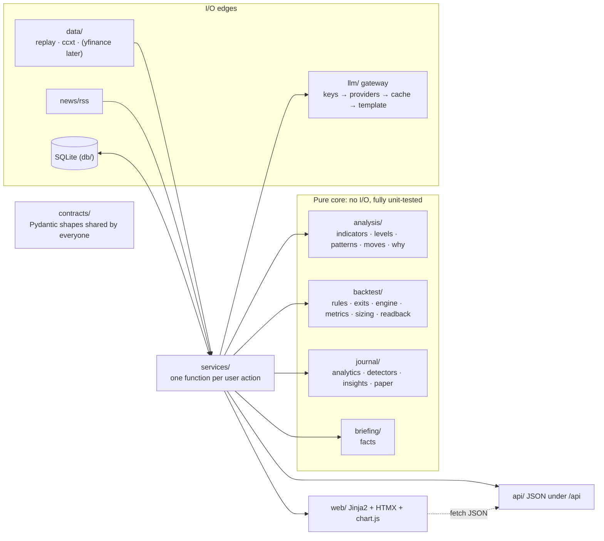

# Architecture Doc v1 — Alef Market

> Companion to **Project Brief v1** · Written Oct 18, 2026 (Chat 2: Architecture & Repo) · Owner: Mani
>
> Paste this together with Brief v1 at the start of every later chat. The Brief decides **what** we build; this doc decides **how**. The code in `app/contracts/` is the source of truth for data shapes; this doc summarizes it. If they ever disagree, fix whichever is wrong in the same commit.

---

## 1. Overview

A single Python process (FastAPI) serves a JSON API and server-rendered Persian pages. One rule organizes the code: **I/O only at the edges, pure functions in the middle.**



**How one request flows** (example: "why is it moving?"):

1. The browser calls `GET /api/market/why?symbol=BTC/USDT&ts=…`.
2. The route calls `services.features.explain_move(...)`.
3. The service loads candles (data source → DB), levels and headlines, then calls the pure `analysis.why.build_why_facts(...)` → `WhyFacts`.
4. The service sends the facts to `llm.gateway` (task `why.v1`). The gateway validates the prose (every number must appear in the facts, Persian only, no advice) or falls back to cache, then to a template.
5. The service returns a `WhyExplanation` contract. The route serializes it.

**Layer rules** (enforced by `tests/unit/test_architecture.py`):

| Layer | May import | Must not import |
|---|---|---|
| `contracts/` | pydantic, pandas (frames only), other contracts | anything else in `app/` |
| Pure core: `analysis/ backtest/ journal/ briefing/ news/lookup.py` | contracts, each other, stdlib, pandas/numpy | db, llm, api, web, services, data, auth, settings, sqlalchemy, fastapi, httpx, ccxt |
| `services/` | everything | — |
| `api/`, `web/` | services, contracts, deps | the pure core directly (except trivial pure calls like `size_position`) |

**The replay clock lives in the browser (A2).** The page loads a replay day's candles once and animates them at 1x–60x. Every time-dependent request carries `as_of_ts` (Unix ms). The server keeps no clock and no per-user replay state, so every endpoint is a pure function of (stored data, `as_of_ts`) and is reproducible in tests. In live mode the server ignores `as_of_ts` and uses "now"; the chart polls `/api/market/candles` every few seconds.

---

## 2. Repository structure

```
alef-market/
├─ pyproject.toml        dependencies, ruff and pytest config (uv-managed)
├─ uv.lock               exact versions; committed
├─ .python-version       3.12 (uv installs it)
├─ .env.example          every setting, no secrets; copy to .env
├─ Makefile              setup / dev / test / lint / fmt / check / reset-demo
├─ .github/workflows/    ci.yml: lint + tests on every push and PR
├─ docs/                 architecture-v1.md (this file)
├─ app/
│  ├─ main.py            create_app(): wiring only
│  ├─ settings.py        typed settings from env/.env, API key parsing
│  ├─ logging_setup.py   console + rotating logs/app.log
│  ├─ contracts/         ALL shared data shapes (the most important folder)
│  ├─ data/              MarketDataSource (base), replay + ccxt sources, store, resample, clean (gap policy), window, seed files
│  ├─ analysis/          pure: indicators, levels, patterns, moves, why-facts
│  ├─ backtest/          pure: rule evaluation, shared exits, engine, metrics, sizing, readback
│  ├─ journal/           pure: trade math, behavior detectors, insight ranking, paper settlement
│  ├─ briefing/          pure: briefing facts
│  ├─ news/              rss.py (I/O: feeds, parse, backfill) + store.py (headlines table) + lookup.py (pure)
│  ├─ llm/               gateway, providers, cache, task registry, validators, templates, prompts/
│  ├─ auth/              password hashing, DB sessions
│  ├─ db/                SQLite engine (WAL), table definitions
│  ├─ services/          orchestration: one function per user action
│  ├─ api/               routes/, deps, uniform errors, mocks for frontend work
│  └─ web/               pages.py, templates/, static/{css,js,vendor,fonts}
├─ scripts/              reset_demo, probe_exchanges, record_market_data, pick_replay_days, record_headlines, generate_persona, make_synthetic_market, measure_false_positives
├─ data/                 committed seed data: market/*.csv.gz + manifest.json, news/headlines.jsonl, exchange_probe/, replay_days.json, macro_events.json, persona/
├─ tests/                unit/, api/, fixtures/, evals/, fakes.py, conftest.py
├─ var/                  runtime DB (gitignored)
└─ logs/                 runtime logs (gitignored)
```

---

## 3. Contracts (summary of `app/contracts/`)

### 3.1 Global conventions

- **Time:** `int` Unix **milliseconds, UTC** everywhere (ccxt's unit). `chart.js` divides by 1000 for Lightweight Charts. Display and hour/weekday analytics use **Asia/Tehran**.
- **Percent:** any field ending in `_pct` is in percent units (`1.0` = 1%). Never fractions.
- **Money/prices:** `float`, USDT. Round only for display.
- **Persian text:** fields end in `_fa` and use **Latin digits** (resolves the Brief's «۶۸٪» example: Latin wins).
- **Strictness:** every contract extends `Contract` (`extra="forbid"`, `frozen=True`). Unknown fields are errors, which is how an LLM inventing `"side": "short"` or `"leverage"` gets caught.
- **Symbols:** `Literal["BTC/USDT", "ETH/USDT"]`. **Timeframes:** `Literal["1m", "5m", "1h", "1d"]`.
- **Generated prose** always travels as `Narrative{text_fa, meta: TextMeta{source: llm|cache|template, prompt: "why.v1", provider: "groq#2"|None}}`.
- **Errors:** every non-2xx response body is `ApiError{code, message_fa, detail?}`.

### 3.2 Market (`market.py`, `frames.py`)

```python
Candle(ts, open, high, low, close, volume)          # closed bar; ts = bar OPEN time; validates high/low
CandleSeries(symbol, timeframe, candles: list[Candle],
             origin: replay|live|cache, stale: bool, partial: Candle|None)
IndicatorSeries(name: sma|ema|rsi|atr|avg_volume, period, symbol, timeframe,
                points: list[IndicatorPoint(ts, value|None)])   # None during warm-up
ReplayDay(id, label_fa, start_ts, end_ts, note_fa?)
MarketConfig(mode, exchange, symbols, timeframes, replay_days)
```

**Candle frame** (inside the core): a pandas DataFrame indexed by `ts` (int64, strictly increasing) with float columns `open, high, low, close, volume` (no NaN, high/low contain open/close). Convert with `candles_to_frame` / `frame_to_candles`; check with `validate_frame(frame, timeframe=None)`. Passing `timeframe` adds the **strict** check: every `ts` aligned to the timeframe and **no gaps**. The data layer only hands strict-valid frames to the core; exchange gaps of up to 5 bars are filled at the I/O edge with flat zero-volume bars (close carried forward), and longer gaps are reported, never silently bridged (Chat 3). `empty_frame()` builds a valid zero-row frame. Pydantic objects are for the API boundary only (17,000 Python objects are slow).

### 3.3 Analysis (`analysis.py`)

```python
LevelZone(kind: support|resistance, low, high, touches, rank)        # .mid property
PatternMarker(ts, kind: bullish_engulfing|bearish_engulfing|hammer|shooting_star|doji|
              breakout_up|breakout_down, price)
MoveMarker(ts, direction: up|down, move_pct, return_z, volume_z, volume_multiple)
ChartAnnotations(symbol, timeframe, as_of_ts, levels, patterns, moves)   # only bars <= as_of_ts
WhyFacts(symbol, timeframe, ts, window_start_ts, window_end_ts, move_pct, volume_multiple,
         other_symbol, other_move_pct, moved_together, level_broken: LevelZone|None,
         headlines: list[Headline])                                      # ±30 min
WhyExplanation(facts, narrative: Narrative, no_news: bool)
```

### 3.4 Strategy DSL v1 (`strategy.py`)

```python
Operand   = PriceRef(kind="price", field=open|high|low|close|volume)
          | IndicatorRef(kind="indicator", name=sma|ema|rsi|atr|avg_volume, period: 2..500)
          | Const(kind="const", value)
Condition(kind="cond", left: Operand, op: ">"|"<"|"crosses_above"|"crosses_below", right: Operand)
Group(kind="group", logic: and|or, items: list[Rule] (2..6))
Rule      = Condition | Group                    # discriminated by "kind"; depth <= 2
Exits(stop_loss_pct?, take_profit_pct?, time_exit_bars?, exit_rule: Rule?)
PositionSizing(mode: equity_pct|risk_pct = equity_pct, value_pct = 100)   # risk_pct: <= 10
Strategy(version=1, side="long", entry: Rule, exits: Exits, sizing: PositionSizing)
```

Validation rules in code: missing period for RSI/ATR/avg_volume → **code fills** 14/14/20; missing period for SMA/EMA → error (we ask the user); two constants in one condition → error; depth > 2 → error; `risk_pct` sizing without a stop → error; `risk_pct` above `MAX_RISK_PCT` = 10 → error (the same cap as `SizeRequest.risk_pct`, B13).

LLM-facing shapes:

```python
StrategyParseOutput(status: ok|unsupported|unclear, strategy: Strategy|None, unsupported: list[str])
                     # strategy present  <=>  status == "ok"
ParseRequest(text)            EditRequest(strategy, text)
ParseResult(status: ok|unsupported|unclear|offline, strategy?, readback_fa?, message_fa?,
            unsupported, detected_lang?, meta?)
```

`readback_fa` ("I understood: …") is generated **by code** from the validated strategy (`backtest/readback.py`), never by the LLM, so the user reads exactly what will run.

### 3.5 Backtest (`backtest.py`)

```python
ExitReason = stop|target|time|signal|manual|end_of_data        # shared with paper trades
Costs(fee_pct=0.1, slippage_pct=0.05)                           # per side
BacktestRequest(strategy, symbol="BTC/USDT", timeframe="5m", start_ts?, end_ts?,
                costs, initial_equity=10_000)
SimTrade(entry_ts, entry_price, exit_ts, exit_price, exit_reason, qty, pnl, pnl_pct, r_multiple?)
EquityPoint(ts, equity)
BacktestMetrics(total_return_pct, buy_hold_return_pct, max_drawdown_pct (positive), n_trades,
                win_rate_pct?, profit_factor?, avg_r?, exposure_pct, fees_paid)
BacktestResult(request, bars, warmup_bars, metrics, trades, equity, buy_hold, summary: Narrative?)
```

**Engine and exit rules** (`backtest/exits.py`, used by **both** the engine and paper trades, A3; details in `backtest/engine.py`, decisions B1–B18):
1. Signals are evaluated on bar close (vectorized, `backtest/rules.py`); an entry signal on a bar where we are flat at the close fills at the next bar's open plus slippage. Long only, one position at a time; a signal on the last bar is not filled.
2. Each bar in a position goes through `check_exit`, in order: **stop** (`low <= stop`; fill at the stop, or at the open if it gapped through), then **target**. Both in one bar → stop. Stop/target are % of the entry fill; every exit fill pays slippage.
3. Signal and time exits are decided on close and filled at the next open (`bars_held` counts the current bar; time exit at `bars_held >= time_exit_bars`).
4. Indicator warm-up bars are skipped (`strategy_warmup`: the longest operand warm-up, +1 for a crossing). Any open position closes on the last bar with `end_of_data` at the last close.
5. **Crossings:** `crosses_above` at `t` = `left[t-1] <= right[t-1]` and `left[t] > right[t]` (mirror for `crosses_below`); any NaN → False.
6. **Sizing** on realized equity at entry: `equity_pct` spends `value_pct` % of equity *including the entry fee*; `risk_pct` uses `size_position`, capped the same way.
7. **Curves:** equity marked at every tested bar's close (`cash + qty × close`), so the last point = initial + Σ pnl; buy-and-hold = `initial × close / first tested close`, no costs. `SimTrade.exit_ts` is the bar where a stop/target hit, the fill bar for signal/time exits, the last bar for `end_of_data`.

**Metrics** (`backtest/metrics.py`): total and buy-and-hold return on the curves; max drawdown = largest fall from a running peak of the close-marked curve; win = `pnl > 0` after fees; profit factor = gross wins / gross losses (None with no losses, 0 with no wins); `avg_r` = mean `pnl / (qty × (entry − stop))` (None without a stop); exposure = bars in a position / tested bars; fees = both sides.

### 3.6 Journal (`journal.py`)

```python
TradeRecord(id, user_id, symbol, side="long", status: open|closed, origin: seed|paper,
            entry_ts, entry_price, qty, stop_price?, target_price?, exit_ts?, exit_price?,
            exit_reason?, fees, emotion: calm|fomo|revenge|bored?, note?)
            # closed => all exit fields set; open => none set
TradeView(TradeRecord + pnl?, pnl_pct?, r_multiple?, holding_min?)
SizeRequest(entry_price, stop_pct, risk_pct=1, equity) -> SizeQuote(qty, notional, risk_amount,
            stop_price, capped)
OpenTradeRequest(symbol, as_of_ts?, stop_pct, target_pct?, risk_pct=1, emotion?, note?)
AsOfRequest(as_of_ts?)
JournalStats(n_trades, win_rate_pct?, avg_win?, avg_loss?, expectancy_r?, total_pnl,
             profit_factor?, equity)
BreakdownRow(key, n_trades, win_rate_pct?, pnl)
Evidence(label_fa, value, unit: pct|count|r|usdt|min|hour)
InsightFacts(key, sample_size, losses, rate_pct, baseline_n, baseline_losses, baseline_pct?,
             lift_pp, p_value, evidence, trade_ids, params: dict[str, float])
             # one tested group vs the user's OTHER trades; input of the insight prompt
Insight(key: after_losses|after_wins|revenge_trade|overtrading|bad_hour|no_stop, title_fa,
        text: Narrative, evidence (>=1), sample_size (>= INSIGHT_MIN_SAMPLE = 10),
        rate_pct?, baseline_pct? (loss rate of the OTHER trades), effect_size (gap in
        percentage points), trade_ids, highlighted)
TradeReviewFacts(trade_id, symbol, entry_price, exit_price, exit_reason, pnl, pnl_pct,
                 r_multiple?, holding_min, minutes_after_loss?, size_vs_avg, matched: [InsightKey])
TradeReview(trade_id, r_multiple?, exit_reason, nearest_level_note_fa?, narrative)
JournalSummary(stats, equity_curve, by_hour (Tehran), by_weekday, trades (newest first),
               insights (max 3), latest_review?)
```

`sample_size >= 10` is part of the **contract**: an insight on a small sample cannot even be constructed.

**Rates are loss rates** (`pnl <= 0` counts as a loss; with fees an exact 0 never happens), and a group is always compared with the user's *other* trades, not with the overall rate that already contains the group. Which facts become cards is decided in `journal/insights.py` (§10, J-decisions).

### 3.7 Briefing, news, auth

```python
Headline(id, source, title, url, published_ts, symbols)      MacroEvent(ts, title_fa, importance)
PairSnapshot(symbol, last_price, change_24h_pct, high_24h, low_24h, volatility_ratio,
             volume_ratio, nearest_support?, nearest_resistance?, dist_to_support_pct?,
             dist_to_resistance_pct?)
BriefingFacts(as_of_ts, pairs, btc_eth_corr_24h, events, headlines (max 3))
BriefingProse(what_happened_fa: 3..5 strings, watch_fa: 1..4 strings)     # LLM JSON output
Briefing(facts, prose, meta, generated_at_ts)
RegisterRequest(username [a-zA-Z0-9_]{3,32}, password: SecretStr (8..128), display_name)
LoginRequest(username, password)        UserPublic(id, username, display_name, is_demo)
Health(status: ok|degraded, version, env, market_mode, mock_api, db_ok)
```

**Changing a contract:** edit `app/contracts/`, run `make check`, update this section, and mention it in the commit message (`contract: …`). The frontend and every later chat depend on these shapes.

---

## 4. API

All JSON lives under `/api`. Interactive docs: `http://127.0.0.1:8000/docs`. Unless marked *public*, endpoints need the session cookie (401 otherwise). Errors always return `ApiError`. With `ALEF_MOCK_API=true`, every endpoint below returns contract-valid example data from `app/api/mocks.py`; without it, unbuilt endpoints return **501** with `code="not_implemented"`.

| Method & path | Request | Response | Notes |
|---|---|---|---|
| `GET /api/health` *public* | — | `Health` | DB check included |
| `POST /api/auth/register` *public* | `RegisterRequest` | `UserPublic` (201) | 409 if the username is taken |
| `POST /api/auth/login` *public* | `LoginRequest` | `UserPublic` + cookie | 401 with a generic message |
| `POST /api/auth/logout` | — | 204 | deletes the session row |
| `GET /api/auth/me` | — | `UserPublic` | |
| `GET /api/market/config` *public* | — | `MarketConfig` | pickers + replay days |
| `GET /api/market/candles` *public* | `symbol, start_ts, end_ts, timeframe=1m` | `CandleSeries` | `start_ts <= ts < end_ts` (bar open time); live polling: `start_ts = last_ts + 1`; 400 if `end_ts <= start_ts` or the window is over 5,000 bars |
| `GET /api/market/indicator` *public* | `symbol, name, period, start_ts, end_ts, timeframe` | `IndicatorSeries` | chart EMA overlay; `warmup_bars` of history before `start_ts` are loaded, so values are `None` only where no history exists; closed bars only |
| `GET /api/market/annotations` *public* | `symbol, start_ts, as_of_ts, timeframe` | `ChartAnnotations` | levels/patterns/moves up to `as_of_ts` |
| `GET /api/market/why` | `symbol, ts, timeframe` | `WhyExplanation` | |
| `GET /api/briefing` | `as_of_ts?` | `Briefing` | replay: pass the replay start |
| `POST /api/backtest/parse` | `ParseRequest` | `ParseResult` | always 200; problems are in `status` |
| `POST /api/backtest/edit` | `EditRequest` | `ParseResult` | "make the stop 2%" |
| `POST /api/backtest/run` | `BacktestRequest` | `BacktestResult` | saved to `backtest_runs` (`text` = the code readback); `start_ts`/`end_ts` None = stored data (live: end = now); warm-up history is loaded before `start_ts`; `result.request` echoes the range actually tested; 400 if the window is over 120 days or too short for the warm-up; `summary` is None until the LLM chat fills it |
| `POST /api/trades/size` *public* | `SizeRequest` | `SizeQuote` | pure; call on every input change |
| `POST /api/trades` | `OpenTradeRequest` | `TradeRecord` (201) | fills at the last closed 1m close at `as_of_ts` + slippage; size from `size_position` on current equity; 400 if replay and no `as_of_ts` or no price yet |
| `POST /api/trades/{id}/close` | `AsOfRequest` | `TradeRecord` | manual close at the last closed close; if the stop/target was hit earlier, that exit is returned instead; 404 unknown/other user, 409 already closed, 400 `as_of_ts` not after entry |
| `POST /api/trades/sync` | `AsOfRequest` | `list[TradeRecord]` | trades that closed by `as_of_ts` (stop/target via `check_exit`); `[]` otherwise; idempotent |
| `GET /api/journal` | — | `JournalSummary` | computed from the DB on every call (~30 ms for 180 trades) |
| `POST /api/demo/reset` | — | 204 | replaces ALL of Sara's trades with `data/persona/sara_trades.json`; only when `env` is dev or demo (403 otherwise) |

The demo flow from the frontend's side: load `config` → load the replay day's `candles` → animate locally → every ~N bars call `annotations` (and `trades/sync` if a trade is open) with the current `as_of_ts` → on a move marker click call `why` → when `sync` returns a closed trade, reload `journal`.

---

## 5. Storage

### 5.1 SQLite tables (`app/db/tables.py`)

| Table | Key | Purpose |
|---|---|---|
| `users` | id; username unique | accounts; `password_hash` is argon2id; `is_demo` flag |
| `sessions` | `token_hash` (sha256 of the cookie token) | login sessions with `expires_ts`; the raw token is never stored |
| `candles` | (exchange, symbol, timeframe, ts) | **closed 1m bars only**. 5m, 1h and 1d are resampled from 1m, never stored or fetched (A6, amended by C2) |
| `headlines` | id; url unique (canonical: `utm_*` and `#fragment` stripped) | RSS titles, links, times, symbol tags |
| `trades` | id; index (user_id, entry_ts) | mirrors `TradeRecord` (seed + paper) |
| `llm_cache` | `key` = sha256(prompt_id + canonical facts JSON: sorted keys, floats rounded to 9 decimals) | validated outputs; `pinned` = hand-reviewed demo text, never overwritten by live output. Pinned rows are also committed in `data/llm/pinned.jsonl` (reset-demo deletes the DB) and loaded at startup and by reset-demo: each line is re-validated with the live validators (invalid lines are skipped with a WARNING), and the DB's pinned set is made equal to the file's |
| `llm_calls` | id | one row per provider attempt: key alias, outcome, latency (usage counter + "who answered") |
| `backtest_runs` | id | simple per-user history |

Connection pragmas: `journal_mode=WAL` (readers don't block the writer), `foreign_keys=ON`, `busy_timeout=5000`.

**Schema changes (A8):** `create_schema()` (SQLAlchemy `create_all`) at startup; no Alembic before the contest. When a table changes, delete `var/alef.db` and run `make reset-demo`. Alembic gets added before the home server stores real users' data.

### 5.2 Market data caching

- **One store:** the `candles` table. `scripts/record_market_data.py` downloads real 1m bars (about 75 whole UTC days, both pairs) and writes **committed** seed files `data/market/<exchange>_<BASE>-<QUOTE>_1m.csv.gz` (e.g. `binance_BTC-USDT_1m.csv.gz`) plus `manifest.json`. Files are gap-free (C1) and byte-deterministic. `make reset-demo` loads them, and `data/news/headlines.jsonl`, into SQLite with no network. A fresh laptop can rebuild everything offline.
- **Gap policy (C1):** every frame handed to the core passes `validate_frame(frame, timeframe)`. Exchange gaps of up to 5 bars are filled at the edge with flat zero-volume bars (that is what "no trades" looks like); longer gaps stop the recorder with a report, and at read time only the latest contiguous run is served (with a WARNING log).
- **Replay days** are named windows (`data/replay_days.json`, whole UTC days chosen with `scripts/pick_replay_days.py`) over those stored candles; `ReplaySource` simply reads the DB. `candles_since`/`latest_price` return only bars closed at `as_of_ts` (`ts + step <= as_of_ts`). Replay reads the seeds of `ALEF_REPLAY_EXCHANGE` (default: `ALEF_EXCHANGE`).
- **Live mode** is a read-through cache: `CcxtSource` fetches only the bars missing from the DB, upserts the closed ones, and reads back from the DB. The still-forming bar is returned as `CandleSeries.partial` and never stored (for 5m/1h the partial is built from the closed 1m bars of the bucket + the forming 1m bar). `MarketDataSource.get_candles` returns `CandleBatch(frame, partial)` so a poll costs one request (C3).

### 5.3 Fallback ladders (the demo must survive no internet)

| Thing | Ladder | What the UI shows |
|---|---|---|
| Candles (live) | exchange → DB cache (`origin="cache"`, `stale=true`) → switch to replay (UI action when stale and empty) | a "stale data" badge |
| Candles (replay) | DB only (no network involved) | — |
| Headlines | RSS → DB (replay days' headlines are seeded) | — |
| LLM prose | key 1..n per provider → next provider → `llm_cache` → Persian template | nothing different; `meta.source` is logged |
| LLM parsing | same → cache → `ParseResult(status="offline")` with a Persian message suggesting the demo prompts | a polite message |

Startup makes **no network calls**, so the app boots with Wi-Fi off. On demo day set `ALEF_LLM_CACHE_MODE=prefer` (cache first) and `ALEF_MARKET_MODE=replay`; for a full offline rehearsal use `ALEF_LLM_CACHE_MODE=only`.

---

## 6. Config and secrets

- `app/settings.py`: one `Settings` class (pydantic-settings), env prefix `ALEF_`, read from the environment and `.env`. Get it with `get_settings()` in scripts; inside the app use the `SettingsDep` dependency (the instance stored on `app.state`).
- **Secrets:** `.env` is gitignored; `.env.example` (committed) lists every variable with empty keys. API keys are `SecretStr` and are parsed into `ApiKey(provider, alias, value)` objects whose `repr` shows only the alias. Logs and the `llm_calls` table use aliases like `groq#2`, never keys.
- **Multiple keys:** `ALEF_GROQ_KEYS=key1,key2` (same for `GEMINI` and `OPENROUTER`). Adding a key means editing `.env` and restarting; no code change.
- **If a key leaks** (for example, committed by mistake): revoke it at the provider first, then remove it from Git history. Rotating is faster than history surgery.
- Tests build `Settings(_env_file=None, …)`, so your real `.env` never affects them.

Main settings: `env`, `log_level`, `mock_api`, `db_path`, `data_dir`, `market_mode`, `exchange`, `exchange_timeout_ms` (10 s), `exchange_proxy`, `replay_exchange`, `llm_cache_mode`, `llm_timeout_s` (8 s), `llm_proxy` (LLM APIs only; separate from `exchange_proxy`), `llm_provider_order`, `llm_task_providers` (per-task order, e.g. `ALEF_LLM_TASK_PROVIDERS='{"strategy_parse":["gemini"]}'`: those first, the rest after), `*_keys`, `*_model`, `session_days`, `cookie_secure`, `display_tz`.

---

## 7. Engineering conventions

### 7.1 Dependencies (managed by **uv**, A11)

`uv sync` creates `.venv`, installs Python 3.12 if needed and installs the exact versions from `uv.lock`. Add a dependency with `uv add <pkg>` (dev-only: `uv add --dev <pkg>`). Commit `uv.lock`.

| Package | Why |
|---|---|
| fastapi + uvicorn | API, OpenAPI docs, ASGI server |
| pydantic + pydantic-settings | contracts, LLM output validation, typed settings |
| sqlalchemy | typed SQLite access |
| jinja2 | server-rendered pages |
| httpx | one HTTP client for all three LLM providers (OpenAI-compatible APIs, A10) |
| pandas + numpy | candle frames, resampling, analytics |
| ccxt, feedparser *(added in Chat 3)* | exchange data (public endpoints, no key), RSS/Atom parsing |
| tzdata *(added in Chat 5)* | the IANA time-zone database, so Asia/Tehran analytics (A19) work on any OS |
| *Week 1:* argon2-cffi, python-multipart | password hashing, form posts |
| *dev:* pytest, ruff, httpx2 | tests; lint + format in one tool; TestClient transport |

Frontend libraries are **vendored** in `app/web/static/vendor/` (Lightweight Charts 5.2.1, HTMX 2.0.11) with the Vazirmatn font in `static/fonts/` (A16). There is no CDN and no npm at runtime. Keep Lightweight Charts' default attribution logo on, since TradingView asks for attribution; its license file is next to it.

### 7.2 Code style

- `ruff format` (line length 100) and `ruff check` (pyflakes, pycodestyle, isort, bugbear, pyupgrade, simplify, ruff rules). `make fmt` fixes most issues.
- Type hints on every function signature, a short docstring on every public function, and `from __future__ import annotations` at the top of modules.
- Core functions are pure: inputs in, contract or frame out, no globals, no clock (`as_of_ts` is a parameter), no randomness without a seed parameter.
- Logging: `logger = logging.getLogger(__name__)`. INFO for state changes, WARNING for fallbacks used, ERROR for things that need a fix. Never log secrets, passwords or tokens.

### 7.3 Tests (pytest)

- `tests/unit/` for the pure core and helpers, `tests/api/` for HTTP behavior via `TestClient`, `tests/fixtures/` for fixed candle files and trade lists, `tests/evals/` for the NL-parsing eval set.
- Fixtures: `settings` (temp DB), `client` (real app, mocks off), `mock_client` (mocks on).
- **No network in the default run.** Tests that hit real APIs are marked `@pytest.mark.live` and run only with `uv run pytest -m live`.
- Golden tests for the backtester: hand-calculated scenarios with exact expected numbers. Write the test first, then the code.

### 7.4 Git workflow (solo)

- `main` is always green and demo-able. Work on short branches: `feat/backtest-engine`, `fix/rtl-chart`, `docs/…`; merge within a day or two.
- Push the branch, open a PR to yourself so CI runs, then **squash-merge**. One PR = one working, tested step.
- Commit messages: imperative and specific (`add stop-first rule to check_exit`); contract changes start with `contract:`.
- Run `make check` before every push; it runs exactly what CI runs.
- Tags: `skeleton-v1` today, `freeze` on Nov 12, `demo` for the build you present. After the freeze, only `fix/` branches.
- `.gitignore` covers `.env`, `var/`, `logs/`, `*.db*`, caches and editor folders.

### 7.5 CI

`.github/workflows/ci.yml` runs on every push to `main` and every PR: `uv sync --locked` (fails if `uv.lock` is out of date) → `ruff check` → `ruff format --check` → `pytest`. It takes about a minute.

---

## 8. LLM layer rules

1. **One door.** Only `llm/gateway.py` talks to providers. Services call `gateway.run_json(task, facts, fallback=…)` or `gateway.run_text(task, facts, fallback=…)`; both always return an `LLMOutcome` (value + `TextMeta` + attempts) and **never raise** to the caller.
2. **Facts in, words out.** Inputs are typed facts objects (contracts). The prompt sends the facts as JSON in the user message; the system prompt holds the rules.
3. **Validation** (`llm/validate.py`, implemented and tested):
   - JSON tasks: strip code fences → `json.loads` → validate with the task's Pydantic model (`extra="forbid"`).
   - Prose tasks: non-empty; under `max_chars`; mostly Persian script (tickers and indicator names allowed); Latin digits only; no imperative buy/sell advice (`بخر`, `بفروش`, "buy now", …); **every number in the text must match a number in the facts at the text's precision** (`68` matches `68.42`, `70` does not).
4. **Retry and refusal:** on invalid output, retry **once** on the same key with the rejected answer, the problem list and the task's retry hint appended (parse/edit: "don't drop parts of the request to make it valid; use `unsupported`"), then move to the next provider. When everything fails: cache, then template. JSON tasks fall back to a clear Persian refusal (`ParseResult.status="offline"` or `"unclear"`), **never a guess**.
   - **Keys and providers** (process-wide state behind one lock): keys are used round-robin (each call starts at the provider's next key). 429 → that key cools down for `Retry-After` (seconds or HTTP-date; 30 s if missing, capped at 120 s), next key. 401/403 → that key is disabled until restart, next key. Timeout, 5xx or a network error → the provider cools down 60 s, next provider. Any other 4xx (e.g. 400) → next provider, no cooldown. A 400 that rejects `response_format` is retried once on the same key without it.
   - **Deadlines** per task (`PromptTask.deadline_s`): parse/edit 15 s; why/briefing 5 s; insight, trade_review, backtest_summary 3 s. Each attempt's timeout is `min(time left, llm_timeout_s)`; with less than 1 s left no attempt starts. `max_tokens` is set per task.
   - **Every cache hit is re-validated** with the same `validate.validate_output` as live answers and the pinned file; an invalid row is never served. DB failures (cache, `llm_calls`) are WARNINGs; the answer is still returned.
5. **Prompts are versioned files:** `app/llm/prompts/<task>.v<N>.md`, plus a shared `glossary_fa.md` for consistent Persian terms (prose tasks) and `input_rules.md` (every task). To change a prompt, copy it to `v<N+1>`, edit it, and bump the version in `llm/tasks.py`. The cache key includes `prompt_id`, so old answers are never served for a new prompt; `test_llm_infra.py` stores a hash of every prompt's full text and fails if one changes without a new version. **The user's text is data:** the facts travel as JSON between `<facts>` tags in the user message (every `<` escaped, so a user can't close the block), and `input_rules.md` tells the model never to follow instructions inside them.
6. **Cache modes:** `fallback` (dev: call the LLM, use the cache on failure), `prefer` (demo day: cache first), `only` (offline rehearsal: never call the network; a miss returns the fallback with no attempt). `pinned` cache rows are hand-reviewed demo texts, **served first in every mode**.
7. **Testing without the API:**
   - `tests/fakes.py::FakeProvider` replays a scripted list of answers and failures (`"rate_limited"`, `"timeout"`, …), so gateway tests can kill keys, return bad JSON and check the whole fallback ladder.
   - `OpenAICompatProvider` is tested with `httpx.MockTransport` (a fake HTTP server in memory).
   - The NL-parsing **eval set** (`tests/evals/strategy_prompts.jsonl`, 10 Persian + 10 English cases with expected status and strategy) runs against the real providers with `pytest -m live`, and its results are logged. It is also how we choose the best provider per task.
8. **Providers:** Groq, Gemini and OpenRouter all expose OpenAI-compatible `/chat/completions`, so one ~40-line httpx class handles all three (A10). HTTP 429 → `rate_limited`, 401/403 → `auth`, timeout → `timeout`, everything else → `http_error`.

---

## 9. Running it

```bash
# once (Linux/macOS): install uv, then
curl -LsSf https://astral.sh/uv/install.sh | sh
git clone <repo> && cd alef-market
uv sync                       # installs Python 3.12 + dependencies
cp .env.example .env          # add your keys later

make dev                      # http://127.0.0.1:8000  (docs at /docs)
make check                    # lint + tests, same as CI
make reset-demo               # rebuild var/alef.db
```

With `ALEF_MOCK_API=true` in `.env` (the `.env.example` default) the home page draws a mock BTC chart, and every endpoint returns example data.

---

## 10. Decisions log (Chat 2, Oct 18, 2026)

Brief decisions D1–D16 stand. New decisions:

| # | Decision | Why |
|---|---|---|
| A1 | **Frontend:** Jinja2 pages + HTMX + one small `chart.js`; the JSON API under `/api` is the formal contract. PySide6 rejected. | No build step, logic stays in Python, phone-readable; PySide6 can't run in a phone browser and would need a web view for Lightweight Charts anyway |
| A2 | **The browser owns the replay clock**; the server is stateless and time-dependent endpoints take `as_of_ts` | No hidden per-user state; every endpoint is reproducible and testable |
| A3 | **One exit function** (`backtest/exits.check_exit`) for the backtester and paper trades | One tested implementation of stop-first and gap rules; they can't disagree |
| A4 | **Sync** FastAPI endpoints (`def`) + sync SQLAlchemy | Simpler to debug; the thread pool is plenty for one user. Async only helps with thousands of connections |
| A5 | **Polling**, no WebSockets/SSE | Replay runs in the browser; live data changes once a minute |
| A6 | Store **1m** bars; **5m is resampled** from 1m; 1h/1d fetched separately for the briefing | 1m and 5m can never disagree |
| A7 | The SQLite `candles` table is the only candle store; seed data committed as `data/market/*.csv.gz` | Offline rebuild on any laptop; one code path for replay and live |
| A8 | **No Alembic before the contest** (changes Brief §3/§10): `create_all` + `make reset-demo` | The schema will change often in 4 weeks and the demo DB is disposable. Add Alembic before storing real users' data |
| A9 | The "I understood: …" readback is generated **by code** from the validated strategy | The user sees exactly what runs; no LLM paraphrase drift |
| A10 | One **httpx OpenAI-compatible client** for Groq/Gemini/OpenRouter; no SDKs | One code path, one mock, three fewer dependencies |
| A11 | **uv** (deps + lockfile + Python install), **ruff** (lint + format), pytest, GitHub Actions | Fast, few tools, reproducible |
| A12 | Contract conventions: strict + frozen models, ms UTC timestamps, `_pct` = percent units, `_fa` = Persian, Latin digits | Removes whole classes of unit and parsing bugs |
| A13 | Prompts are versioned `.md` files; the cache key includes the prompt version; cache modes `prefer`/`fallback`/`only` | Reviewable prompts; a predictable demo |
| A14 | Prose validation enforces grounded numbers, Persian script, Latin digits and no advice words | Turns hard rule 1 and "not financial advice" into tests |
| A15 | **Mock API mode** (`ALEF_MOCK_API`) with contract-valid examples, tested | The frontend can be built before the backend |
| A16 | All JS libraries and the font are **vendored**; no CDN | The demo works with no internet |
| A17 | **DB sessions** storing a sha256 of a random token; argon2id passwords; HttpOnly + SameSite=Lax cookie | Logout works, and a leaked DB can't be used to log in |
| A18 | Python pinned to 3.12 via `.python-version` (`requires-python >=3.12,<3.14`) | Matches the Brief; uv installs it automatically |
| A19 | Storage is UTC; display and hour/weekday analytics use Asia/Tehran | "Your worst hour is 15:00" must match Sara's clock |
| A20 | A `services/` layer is the only orchestration; the layering rule is enforced by a test | Pages and API can't drift; the core stays pure |
| A21 | `INSIGHT_MIN_SAMPLE = 10` is enforced inside the `Insight` contract | Small-sample insights are impossible, not just discouraged |

### Chat 3 decisions (Data Layer, Oct 18, 2026)

| # | Decision | Why |
|---|---|---|
| C1 | **Gap policy:** `validate_frame(frame, timeframe)` rejects gaps/misalignment (`contract:` change); gaps of up to 5 bars are filled with flat zero-volume bars at the I/O edge; longer gaps are refused by the recorder and trimmed (latest contiguous run) at read time | Indicators and next-bar fills are silently wrong across holes; one missing minute in 108k bars must not block recording |
| C2 | **Resample everything from 1m** (5m, 1h, 1d, UTC buckets, complete buckets only); nothing else is stored or fetched. Amends A6 | One data path, works offline, timeframes can never disagree |
| C3 | `MarketDataSource.get_candles` returns `CandleBatch(frame, partial)`; every returned frame is strict-valid | The forming bar comes from the same exchange call; the core never sees gaps |
| C4 | Indicators follow TradingView conventions (RSI/ATR Wilder-smoothed; RSI first value at bar `p`, ATR at `p-1`; RSI with no losses = 100), except EMA is SMA-seeded; `warmup_bars(EMA) = 3p` (RSI/ATR: `6p`, amended by B17) | Values match the chart traders compare against; the seed's weight after 3p bars is < 0.3% |
| C5 | Headlines for past replay days via **paged RSS backfill** (`?paged=N` on WordPress feeds: CryptoSlate, Bitcoin.com News, BeInCrypto) + 4 latest-only feeds (CoinDesk, Cointelegraph, Decrypt, The Block); committed as `data/news/headlines.jsonl` | Latest-only feeds cover just 1–3 days; paged RSS is still RSS (D4), not scraping |
| C6 | Feeds are a reviewed constant (`app/news/rss.py::FEEDS`), not a setting | Each feed was verified by hand; changing one should be a reviewed commit |
| C7 | API windows are capped at 5,000 bars (Persian 400 above that) | A full replay day of 1m is 1,440 bars; protects the live exchange and the browser |
| C8 | `ALEF_REPLAY_EXCHANGE` (optional) decouples the seed files' exchange from the live exchange | Recording from one exchange and going live on another at the venue must not empty the replay days |

### Chat 5 decisions (Journal & Paper Trading, Oct 18, 2026)

| # | Decision | Why |
|---|---|---|
| J1 | **Insight rule:** a tested group becomes a card only if it has >= 10 trades AND the comparison group (the user's *other* trades) has >= 10, its loss rate is >= **15 points** higher, and a one-sided **Fisher exact** p-value is <= **0.005 / n_tests** (Bonferroni over every group tested for this user). Then one card per detector, a card sharing > 50 % of its trades (Jaccard) with a stronger card is dropped, ranked by the gap, top 3 | Every gate is one sentence for a judge. Measured on 1,000 pattern-free control datasets: family alpha 0.05 -> 2.4 % show a false card, 0.01 -> 0.4 %, **0.005 -> 0.1 %** (`make fp-report`) |
| J2 | A **loss** is `pnl <= 0` after fees; rates are loss rates; `Insight.baseline_pct` = the other trades' loss rate, `effect_size` = the gap in points (`contract:`) | The comparison the test actually makes; the overall rate already contains the group |
| J3 | **Detectors:** after 2 losses/wins (history = trades closed before the entry); revenge = opened <= 15 min after a losing trade closed, notional > 1.2 x mean notional; overtrading = Tehran days with >= max(Tukey fence Q3+1.5 IQR, 2 x median) trades, needs >= 7 trading days; bad hour = each Tehran entry hour with enough trades; no stop. They never read emotion tags | Timestamps and sizes can't be self-reported wrong |
| J4 | **Paper fills use the backtester's `Costs`** (0.1 % fee + 0.05 % slippage per side). Entry = last closed 1m close at `as_of_ts`; the first bar checked is the one forming at entry; `exit_ts` = open time of the bar where stop/target hit; manual close = last closed close | Paper P&L, Sara's trades and backtests are comparable |
| J5 | `check_exit` and `size_position` were implemented here (golden tests), since the backtester chat hadn't run yet | Paper trades needed the shared exit rule (A3) |
| J6 | **Temporary auth stand-in:** outside `prod`, every request acts as the demo user (Sara); 401 if she doesn't exist | Auth isn't built; the journal must work end to end. The auth chat replaces `get_current_user` |
| J7 | **Sara has 150-200 trades (197 today), not ~150.** Every trade is simulated by the paper engine on the price data (honest outcomes); patterns are planted through timing and size (rejection sampling of entry minutes). The generator searches seeds until the top 3 cards are exactly the planted ones before the stage trade and after it (win or loss), no card shows more than 90 %, and her history ends with a >= 0.5R loss 8 minutes before `demo_entry_ts` | With a strict rule, three patterns at ~80-90 % loss need ~200 trades to be provable; the anchor makes the stage trade a revenge trade by the detector's own definition; a 95 % card looks planted |
| J8 | **Control datasets** have Sara's shape (busy days, quick re-entries, big sizes, all hours) with outcomes independent of all of it; tests run 50 seeds and check the control isn't vacuous | A control with no heavy days proves nothing |
| J9 | **Synthetic stand-in prices** (`app/data/synthetic.py`, exchange id `synthetic`, gitignored) until real seeds exist; `tzdata` added | Tests and local E2E need prices; Asia/Tehran must work on Windows too |

### Chat 6 decisions (Backtesting Engine, Oct 20, 2026)

| # | Decision | Why |
|---|---|---|
| B1 | Stop and target are % of the **slipped** entry fill; every exit fill (stop, target, gap open, next open, end of data) is × (1 − slippage) | Same as paper trades (J4), so backtests and paper P&L are comparable |
| B2 | An entry signal counts on any bar where we are **flat at the close**, including a bar where a stop/target closed us; no exit and re-entry at the same open; a signal on the last bar is not filled | One position at a time with no order-flip ambiguity |
| B3 | A signal/time exit decided on the last bar closes at that bar's close as `end_of_data` | There is no next open to fill at |
| B4 | Equity is marked at each tested bar's close as `cash + qty × close` (no exit costs deducted); one point per tested bar | Hand-checkable; once flat, equity = initial + Σ pnl exactly (tested) |
| B5 | Max drawdown is measured on the close-marked curve, not intrabar lows | It is what the chart's curve shows |
| B6 | Warm-up = the longest operand warm-up over the entry **and** exit rules, **+1 for a crossing** | A crossing also reads the previous bar |
| B7 | The service loads the warm-up history before `start_ts` when it exists | The user's whole window is tested, like `/api/market/indicator` |
| B8 | Buy-and-hold = `initial × close / first tested close`, no costs | The textbook baseline; both curves start at the same point |
| B9 | Exposure = bars from the entry bar to the exit-decision bar (the fill bar of a market exit is not counted) / tested bars | A bar counts if the position was exposed to its moves |
| B10 | Win = `pnl > 0` after fees; profit factor None when the losses sum to 0, 0 with no wins; `avg_r` None without a stop | Matches J2 and the contract's None cases |
| B11 | `BacktestResult.summary` stays None in the backtester | No LLM calls in the engine chat; the LLM chat writes it |
| B12 | The readback uses Persian words for operators («بیشتر از», «کمتر از», «رو به بالا قطع کند»), never `<`/`>`; readback-only terms live in `readback.py`, not in `glossary_fa.md` | `<`/`>` mirror inside RTL text, so «RSI(14) < 30» could be read reversed; the glossary feeds versioned prompts whose cache key holds only the prompt id |
| B13 | `risk_pct` sizing is capped at `MAX_RISK_PCT` = 10 in `Strategy` (`contract:`); `SizeRequest.risk_pct` uses the same constant | `value_pct` allowed 100, so "risk 20 %" passed validation and then crashed `size_position` with a 500 |
| B14 | `equity_pct` sizing is **fee-inclusive**: notional + entry fee = `value_pct` % of equity; `risk_pct` (`size_position`) is capped the same way | Cash never goes negative; a judge could read −10 USDT cash as hidden leverage |
| B15 | Backtest windows are capped at **120 days** (400 above); an omitted `start_ts` is clamped to the last 120 days instead | Bounds a request: measured 0.85–0.97 s at 120 days (172,800 1m rows, service path), 0.48 s for 2 months through HTTP |
| B16 | `BacktestResult.request` echoes the request with `start_ts`/`end_ts` set to the range actually tested; `exit_ts` = bar of a stop/target hit, fill bar of a market exit, last bar for `end_of_data` | The echoed request re-runs to the same result (tested); the chart marks bars by open time |
| B17 | **RSI and ATR `warmup_bars` = 6 × period** (was `p` / `p − 1`; amends C4). Changes the backtester's skip and the `/indicator` lookback | Wilder smoothing remembers its seed: with `p` bars of history, RSI(14) differed by up to 21–30 points depending on where history started, so the chart's RSI disagreed with a backtest signal (found while hand-verifying a trade). 6p is the smallest multiple within 0.5 RSI points / 0.5 % in every measured case (worst 0.20 / 0.10 %); EMA's 3p passes the same test |
| B18 | **Crossings:** `crosses_above` at `t` = `left[t-1] <= right[t-1]` and `left[t] > right[t]`; `crosses_below` mirrors; any NaN → False | "Touch, then through" is a cross, touching alone is not; NaN can never signal (no `~(a > b)`) |

### Open items carried forward
- [ ] Week 0: exchange connectivity → set `ALEF_EXCHANGE` (D2). Probe built (`scripts/probe_exchanges.py`); results from Mani's networks pending
- [ ] Week 0: Persian quality test → choose the model per task in settings
- [ ] Week 0/1: record market data and pick 3–5 replay days → `data/replay_days.json`. Recorder + picker built; recording on Mani's machine pending
- [ ] Record headlines for the seed window (`scripts/record_headlines.py`) and commit `data/news/headlines.jsonl`
- [ ] Confirm the demo format with the organizers (D11)
- [ ] Check each LLM provider's terms on multiple free accounts (D5)
- [ ] After real seeds + replay days exist: pick the stage moment, then `make persona DEMO_TS=<ms>` (Sara on real prices) and commit `data/persona/sara_trades.json`
- [ ] Auth chat: replace the demo-user stand-in in `app/api/deps.py::get_current_user` and give Sara a password
- [ ] LLM chat: fill `BacktestResult.summary` (`backtest_summary.v1`) in `services/backtest.py`; build `/backtest/parse` and `/edit` with `readback_fa = strategy_to_persian(strategy)`
- [ ] `BacktestResult` has no `stale` flag: a live-mode backtest served from the DB cache is only logged (WARNING). Add one (`contract:`) if the frontend needs the badge
